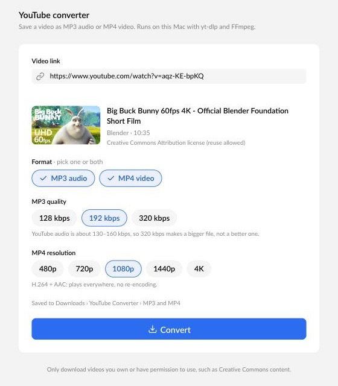

# YouTube Converter

A small local app that saves a YouTube video as **MP3**, **MP4**, or **both**, straight into your Downloads folder. It runs on your own computer at `http://127.0.0.1:8765`; nothing is uploaded anywhere.

**Website:** https://randyvarianda.github.io/yt-converter/



## Features

- MP3 (128 / 192 / 320 kbps), MP4 (360p–4K), or both from one link
- Files go to `~/Downloads/YouTube Converter/MP3/` and `.../MP4/`, with a "Show in Finder" button
- Video preview, progress bar, light and dark mode

## Install and run

Needs Python 3.10+, [FFmpeg](https://ffmpeg.org) and [Node.js](https://nodejs.org). On macOS:

```bash
brew install python ffmpeg node
git clone https://github.com/randyvarianda/yt-converter.git
cd yt-converter
./run.sh
```

Open http://127.0.0.1:8765. The first run creates `.venv/` and installs [yt-dlp](https://github.com/yt-dlp/yt-dlp).

When YouTube changes something and conversions start failing, update yt-dlp:

```bash
.venv/bin/pip install -U "yt-dlp[default]"
```

"Show in Finder" is macOS-only; everything else should work on Linux too.

## How it works

- `server.py`: a standard-library Python HTTP server, bound to 127.0.0.1 only. It uses **yt-dlp** to get the video's streams (solving YouTube's JavaScript challenges with Node) and **FFmpeg** to encode MP3 or merge video and audio into MP4. Each file is built in a temp folder and moved into Downloads only when complete.
- `static/index.html`: the whole UI, no build step.
- `docs/`: the GitHub Pages site.

It can't be a hosted website: GitHub Pages only serves static files, and a browser can't fetch or convert YouTube streams by itself.

## Use responsibly

Only download videos you own or have permission to use, such as your own uploads or Creative Commons content. Downloading other videos may break YouTube's Terms of Service and copyright law where you live. Not affiliated with YouTube or Google.

## License

MIT. Bundles Lato (SIL Open Font License, `static/fonts/LICENSE.txt`) and Lucide icons (ISC, `static/icons/LICENSE`). The screenshot shows *Big Buck Bunny* © Blender Foundation, CC BY 3.0.
